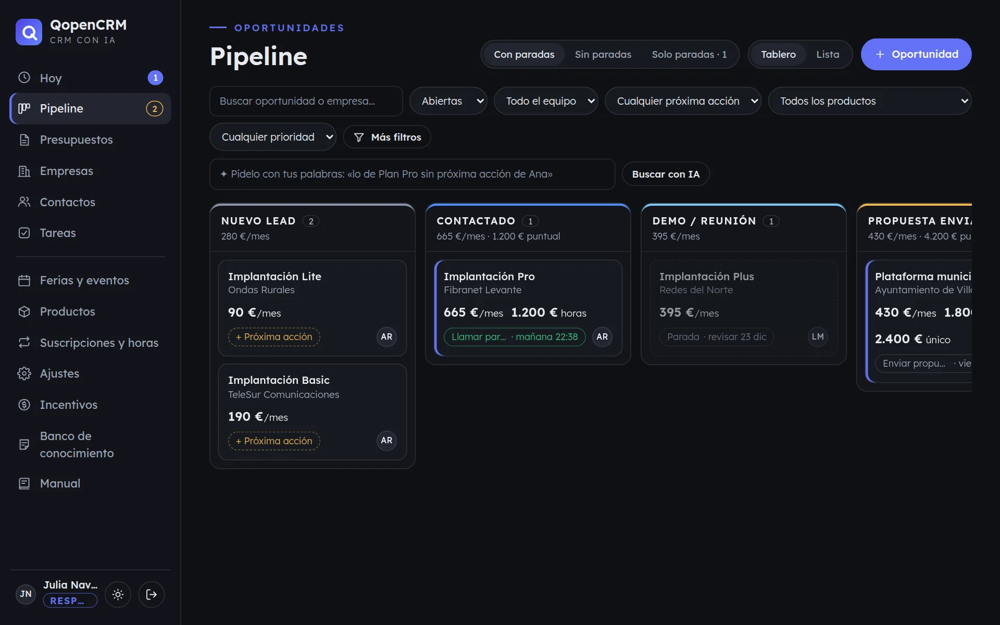
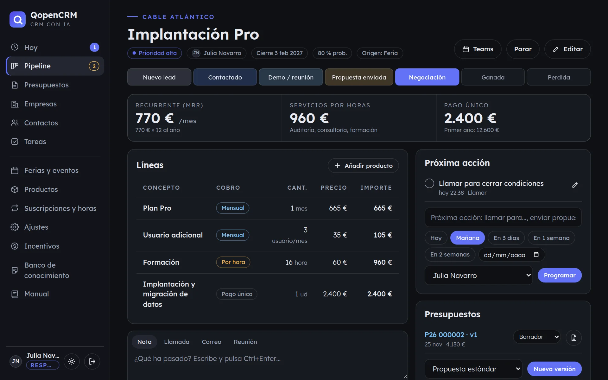
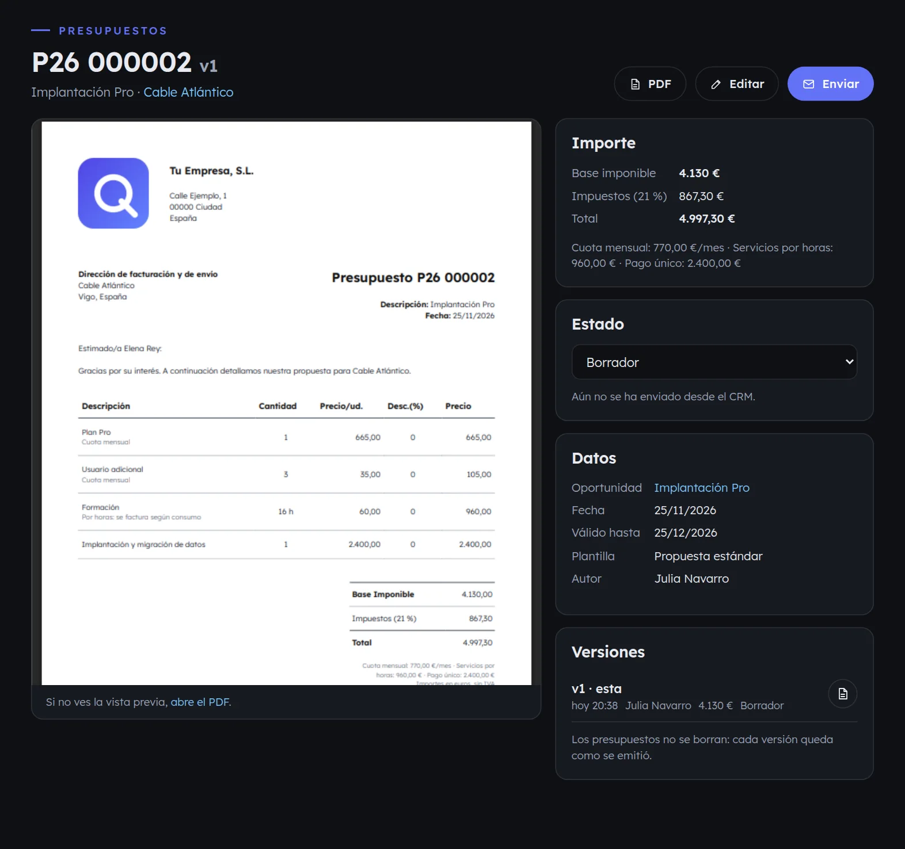
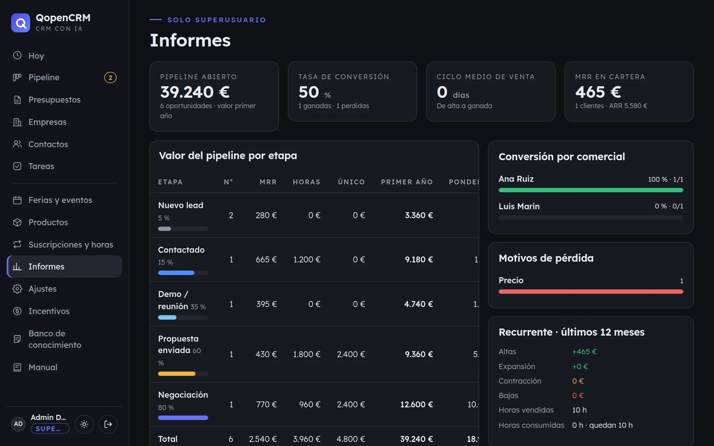
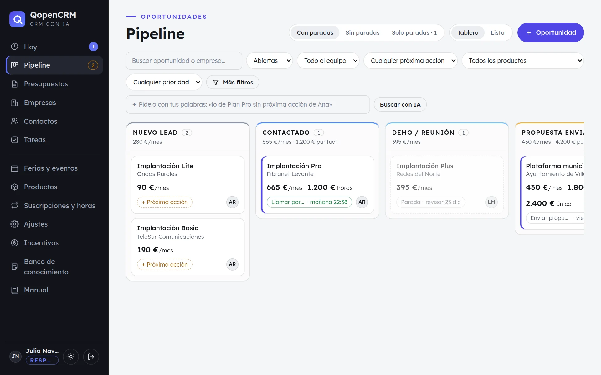

<div align="center">


# QopenCRM

**El CRM comercial de código abierto con IA.**
Pipeline, presupuestos en PDF, suscripciones y un servidor MCP para que tu asistente de IA trabaje el CRM contigo.

[](https://github.com/juaquicar/QopenCRM/actions/workflows/ci.yml)
[](LICENSE)
[](https://www.python.org/)
[](https://www.djangoproject.com/)
[](https://www.postgresql.org/)
[](docs/INSTALACION.md)
[](docs/IA.md)
[](docs/API.md)
[](CONTRIBUTING.md)

[Instalación](docs/INSTALACION.md) · [Configuración](docs/CONFIGURACION.md) · [IA y MCP](docs/IA.md) · [API](docs/API.md) · [Desarrollo](docs/DESARROLLO.md) · [Contribuir](CONTRIBUTING.md)



</div>

> **English summary.** QopenCRM is an open-source, self-hosted, AI-native sales CRM: kanban pipeline, PDF quotes,
> subscriptions (MRR), a REST API with signed webhooks and a built-in **MCP server**, so assistants such as Claude can
> read and update your CRM with each user's own permissions. Django + PostgreSQL + htmx, one command to install with
> Docker. The interface and the documentation are in Spanish for now; translations are welcome.

## Por qué QopenCRM

- **La IA no es un añadido.** Trae un [servidor MCP](docs/IA.md) con 43 herramientas: tu asistente consulta el
  pipeline, crea leads, anota llamadas, programa la próxima acción o genera un presupuesto, siempre con los permisos de
  quien lo conecta. Además, rellena fichas desde un texto pegado y busca en el pipeline con lenguaje natural.
- **Tus datos, en tu servidor.** Se autoaloja con Docker en un comando. Sin telemetría y sin límites por usuario.
- **Hecho para vender, no para rellenar campos.** Cada oportunidad abierta tiene una próxima acción con fecha; el CRM
  te avisa de las que no la tienen.
- **Dinero bien contado.** Recurrente mensual (MRR), servicios por horas y pago único van siempre por separado.
- **Ligero.** Django, PostgreSQL y htmx. Sin compilación de frontend y sin dependencias de pago.

## Qué incluye

| | |
|---|---|
| **Pipeline** | Tablero arrastrable o lista, etapas y probabilidades configurables, oportunidades paradas a la espera del cliente con fecha de revisión, motivos de pérdida. |
| **Empresas y contactos** | Deduplicación por nombre, CIF y dominio, fusión de duplicados, historial completo, importación CSV con comprobación previa. |
| **Tareas** | Próxima acción por oportunidad, recordatorios por correo y resumen diario. |
| **Presupuestos** | Editor con totales al momento, PDF versionado (nunca se sobrescribe una versión), plantillas y envío por correo desde el CRM. |
| **Suscripciones y horas** | Al ganar una oportunidad sus líneas pasan a suscripciones y bolsas de horas; altas, expansiones, contracciones y bajas quedan registradas. |
| **Catálogo** | Productos por familias, con modelo de cobro recurrente, por hora o pago único. |
| **Informes** | Valor del pipeline por etapa, conversión, motivos de pérdida, recurrente y previsión. |
| **Ferias y eventos** | De qué evento salió cada empresa y qué negocio ha dado. |
| **Incentivos** | Tres programas de ejemplo (cliente nuevo, cuota recurrente y jefe de proyecto) con lo previsto, lo devengado y lo abonado. |
| **Banco de conocimiento** | Documentación interna en Markdown, por categorías y con visibilidad por rol. |
| **Captura de correo** | Un buzón compartido en copia y el historial de cada empresa se rellena solo, invitaciones de calendario incluidas. |
| **Microsoft Teams** | Convoca reuniones de Teams desde una oportunidad (Microsoft Graph). |
| **IA** | Servidor MCP con OAuth 2.1, «Rellenar con IA» y búsqueda en lenguaje natural (OpenAI o Anthropic). |
| **API y webhooks** | API REST documentada con OpenAPI, claves personales y webhooks firmados con HMAC-SHA256. |
| **Seguridad y RGPD** | Acceso sin contraseñas (código al correo), roles configurables, registro de accesos, base legal por contacto y derecho de supresión. |
| **Móvil** | PWA instalable y proyecto Android (Trusted Web Activity) para compilar tu propia app. |
| **Operación** | Un script para instalar, actualizar, hacer copias (local, FTP, FTPS o SFTP) y restaurar. |

<div align="center">
 
 
</div>

## Puesta en marcha en dos minutos

Necesitas Linux o macOS con [Docker](https://docs.docker.com/engine/install/) y Docker Compose.

```bash
git clone https://github.com/juaquicar/QopenCRM.git
cd QopenCRM
./qopencrm.sh install     # crea .env, construye, arranca y crea el primer superusuario
./qopencrm.sh demo        # opcional: equipo, catálogo y pipeline ficticios para probar
```

Abre `http://localhost:8000` y entra con tu correo. No hay contraseñas: llega un código de 6 cifras. Mientras no
configures SMTP, el código sale en los registros:

```bash
./qopencrm.sh logs web | grep 'código de acceso'
```

Guía completa, con HTTPS automático y copias de seguridad: [docs/INSTALACION.md](docs/INSTALACION.md) y
[docs/DESPLIEGUE.md](docs/DESPLIEGUE.md).

## Tu asistente de IA, dentro del CRM

Cada instalación publica un servidor MCP en `https://tu-crm/mcp/`.

**Claude (web, escritorio o móvil):** Ajustes → Conectores → Añadir conector personalizado → pega la dirección. Se
abre el CRM, entras con tu correo y pulsas **Autorizar**. No hace falta ninguna clave.

**Claude Code y otros clientes MCP**, con una clave de API personal (Ajustes → Mis claves de API):

```bash
claude mcp add --transport http qopencrm https://tu-crm/mcp/ --header "Authorization: Bearer qcrm_TU_CLAVE"
```

Y a partir de ahí, con tus palabras:

> «¿Qué tengo para hoy?» · «Oportunidades sin próxima acción» · «Crea un lead de Operadora del Sur con Plan Plus y
> recuérdame llamar el jueves» · «Anota que he hablado con Marta y quiere demo» · «Genera el presupuesto de Cable
> Atlántico»

El asistente ve y cambia solo lo que puede ver y cambiar la persona conectada, y cada acción queda en el registro de
accesos. Todo el detalle, en [docs/IA.md](docs/IA.md).

## Documentación

**Para usar QopenCRM**

| Documento | Contenido |
|---|---|
| [Instalación](docs/INSTALACION.md) | Requisitos, instalación con Docker, primer acceso, datos de demostración. |
| [Configuración](docs/CONFIGURACION.md) | Todas las variables de `.env`: correo, captura de buzón, IA, copias, identidad. |
| [Despliegue](docs/DESPLIEGUE.md) | Producción: HTTPS, proxy inverso, copias programadas, actualización y restauración. |
| [IA y MCP](docs/IA.md) | Conectar asistentes, herramientas disponibles, permisos y privacidad. |
| [API y webhooks](docs/API.md) | Autenticación, recursos, ejemplos y verificación de firmas. |
| Manual de usuario | Dentro de la aplicación, en **Manual**: se adapta a los permisos de tu rol. |

**Para desarrollar QopenCRM**

| Documento | Contenido |
|---|---|
| [Desarrollo](docs/DESARROLLO.md) | Entorno local, arquitectura, convenciones, pruebas y cómo añadir una herramienta MCP. |
| [Contribuir](CONTRIBUTING.md) | Flujo de trabajo, estilo de commits y qué se espera de una PR. |
| [Seguridad](SECURITY.md) | Cómo avisar de una vulnerabilidad. |
| [Cambios](CHANGELOG.md) | Historial de versiones. |

## Tecnología

Python 3.14 · Django 6.1 · Django REST Framework · PostgreSQL 18 · htmx · WeasyPrint (PDF) · Caddy (TLS automático) ·
uv · Docker Compose.

```
apps/accounts       usuarios, roles, acceso por código y registro de accesos (RGPD)
apps/catalog        familias y productos con su modelo de cobro
apps/crm            empresas, contactos, pipeline, tareas, informes, importación y exportación
apps/sales          presupuestos en PDF, suscripciones y bolsas de horas
apps/integrations   API REST, servidor MCP, OAuth, webhooks, captura de correo, IA y Microsoft Teams
apps/incentives     programas de incentivos del equipo
apps/knowledge      banco de conocimiento en Markdown
```

## Contribuir

Las aportaciones son bienvenidas: errores, ideas, traducciones, documentación y código. Empieza por
[CONTRIBUTING.md](CONTRIBUTING.md) y por las incidencias marcadas como
[`good first issue`](https://github.com/juaquicar/QopenCRM/labels/good%20first%20issue).

```bash
docker compose up -d db
uv run python manage.py migrate && uv run python manage.py seed --admin tu@correo.example
uv run python manage.py runserver
uv run python manage.py test apps
```

## Licencia

[MIT](LICENSE). Úsalo, modifícalo y despliégalo donde quieras, también con fines comerciales.
